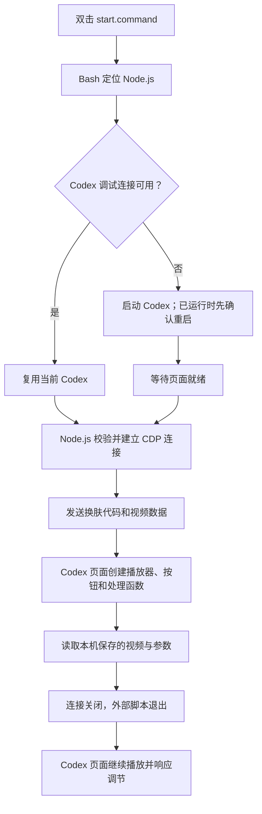
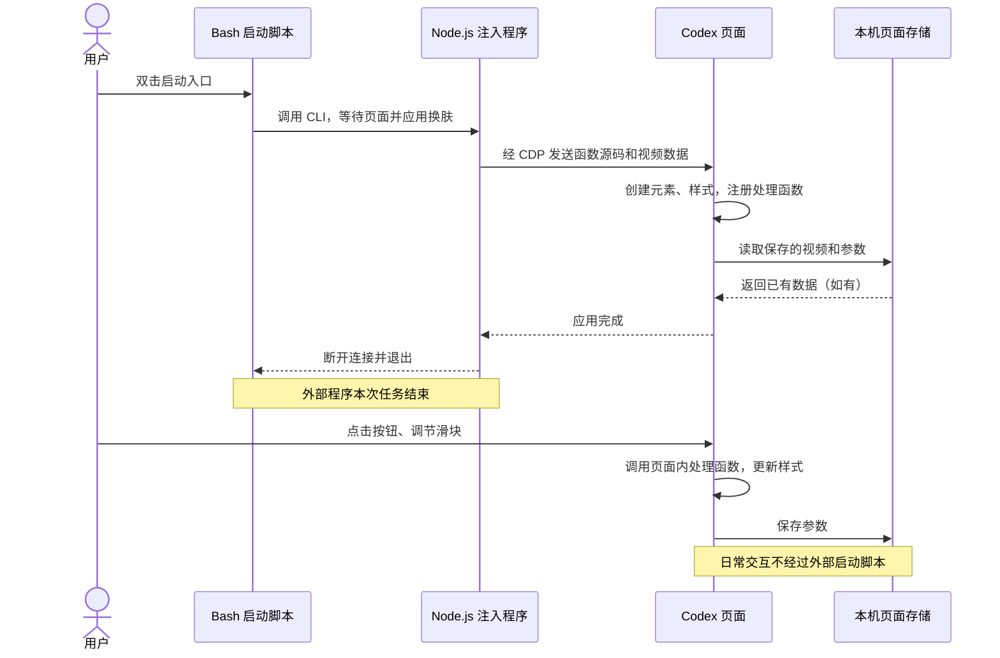
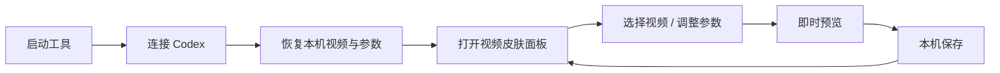

# Codex Video Skin · macOS 最小原型

把本地 H.264 MP4 放在 Codex 原生界面背后静音循环播放。代码不修改 ChatGPT.app、账号、模型设置或原有 DreamSkin 配置。

## 使用

- 双击 `start.command`：启动/连接支持视频背景的 Codex。普通启动的 Codex 需要确认重启。
- 双击 `control.command`：暂停、继续、调整遮罩、恢复原生界面或查看播放状态。
- 点击 Codex 右下角 **视频皮肤**，选择本地视频并实时调整；完成后收起面板。
- 文字深浅、全局遮罩、左侧栏底色、输入框底色、文字阴影、完整显示/填满窗口均可调。底色 0% 完全透明，100% 实底；文字本身不跟随透明度变淡。
- 参数按视频内容的 SHA-256 保存；再次选择同一内容的视频自动恢复。当前视频保存在本机 IndexedDB，只有一份活动视频副本；换视频时覆盖这份副本，参数仍按视频分别保留。
- 下次双击 `start.command` 会恢复已保存的视频与参数。普通启动不自动注入，仍需使用此启动入口。显式 `apply 文件路径` 会替换保存的活动视频。
- 视频需为 H.264 MP4，建议 1080p / 30fps，最大 64 MiB。设置面板也允许选择 WebM / MOV，但能否播放取决于其内部编码；选择不支持的文件会提示错误并保留当前视频。首次命令行应用失败会清理注入层。

需要 macOS、`/Applications/ChatGPT.app` 和 Node.js 22+。不需要 npm install、数据库、Docker 或 HTTP 服务。工具优先使用 PATH 中的 Node，然后使用客户端内置 Node / 本机 nvm。

## 架构：脚本如何让换肤功能留在 Codex 中

本项目是一套 **Bash 启动脚本 + Node.js 注入程序 + Codex 页面内 JavaScript**，目前不是独立 macOS App，也不是 Codex 官方插件。它不修改 Codex 安装文件，没有后台常驻注入服务。

### 文件、语言与运行位置

| 文件 / 技术 | 运行在哪里 | 职责 | 何时结束 |
| --- | --- | --- | --- |
| `start.command`：Bash | macOS 终端进程 | 连接现有 Codex，或启动带本机调试接口的 Codex；调用 Node.js 注入程序 | 应用完成或报错后退出 |
| `scripts/env.sh`：Bash | 启动脚本所在进程 | 定位 Node.js，进入项目目录 | 随启动脚本结束 |
| `src/cli.mjs`：JavaScript | 外部 Node.js 进程 | 校验连接对象、读取视频、发送换肤代码和视频数据 | 操作完成后关闭连接并退出 |
| `src/cdp.mjs`：JavaScript | 同一个 Node.js 进程 | 通过 WebSocket 封装 CDP 请求与返回结果 | 随 Node.js 进程结束 |
| `src/renderer.mjs`：JavaScript | 函数源码被发送到 Codex 页面后，在该页面内执行 | 创建视频、遮罩和样式；处理播放、暂停、透明度和清理 | 页面重载、关闭或主动恢复原生界面时清除 |
| `src/panel.mjs`：JavaScript、HTML、CSS | 函数源码被发送到 Codex 页面后，在该页面内执行 | 创建右下角设置面板、注册交互、保存视频与参数 | 随页面或换肤功能清除 |
| `control.command`：Bash | 用户另行启动的终端进程 | 调用 CLI，临时连接已有换肤功能进行控制 | 本次控制结束后退出 |

`.command` 是 macOS 可通过终端双击执行的脚本入口后缀，本项目的首行 `#!/bin/bash` 指定使用 Bash。Shell 可以调用其他程序，所以能够通过 `node src/cli.mjs apply` 执行 JavaScript；JavaScript 的解释执行由 Node.js 负责。`.mjs` 表示 ES 模块格式的 JavaScript 文件。

### 启动与注入链路

1. 用户双击 `start.command`，Bash 先找到可用的 Node.js。
2. 如果当前 Codex 已开放可验证的调试接口，就直接复用；如果未启动则启动；如果已经运行却未开放接口，则提示用户确认重启。端口被无法验证的进程占用时停止，不抢占端口。
3. 启动 Codex 时指定本机调试地址 `127.0.0.1:10270`，等待受支持的主页面就绪。脚本可以先启动，但必须等页面存在后才能注入。
4. Node.js 程序检查端口所属进程，连接目标页面，通过浏览器调试协议 **CDP（Chrome DevTools Protocol）** 的 `Runtime.evaluate` 让页面执行我们的函数源码。
5. 页面创建视频播放器、遮罩和 CSS。默认 MP4 从本机读取，经 CDP 分块传入页面，在页面中组装成 Blob 并播放；不需要 HTTP 视频服务器。
6. 页面创建设置面板，读取本机保存的视频和参数。默认应用会尝试恢复上次视频，显式指定视频路径则以指定文件为准。
7. 应用完成后，Node.js 关闭 CDP 连接，启动脚本退出。之后的视频播放和面板交互由 Codex 内部的页面环境负责。



### 为什么脚本退出了，右下角按钮还在？

**函数执行完毕，不等于函数创建的页面元素和事件处理函数被删除。** 注入代码执行时已经把按钮加入 Codex 页面的元素树（DOM），并注册了“点击时执行什么”“滑块变化时执行什么”等事件监听器。只要页面还保留这些元素和监听器，它们就继续存在。

按钮通过 `position: fixed`、`right: 18px`、`bottom: 18px` 固定在窗口右下角；设置面板使用 Shadow DOM 隔离内部样式，减少和 Codex 原生样式相互影响。视频由 Codex 内部的 HTML 视频播放器持续播放，不依赖外部脚本循环驱动。

点击按钮时，Codex 的页面引擎直接调用已经保留在页面内存中的函数。**Codex 不需要持续向外部启动脚本发送消息，外部脚本也不需要一直运行。** 用户后来主动执行 CLI 或 `control.command` 时，才会另行建立一次临时 CDP 连接。



### 生命周期与持久化

| 操作 | 页面里的换肤功能 | 本机保存的视频和参数 |
| --- | --- | --- |
| 外部启动脚本退出 | 继续运行，不受影响 | 保留 |
| 收起设置面板 | 按钮和播放器继续存在 | 保留 |
| 暂停视频 | 播放暂停，设置仍可调 | 保留 |
| 执行 `restore` 恢复原生界面 | 清理视频、面板、样式和监听器 | 保留，供以后重新应用 |
| 页面重载或 Codex 完全退出 | 当前页面里的注入内容消失 | 通常保留 |
| 再次通过启动入口应用 | 重新创建换肤功能，恢复保存内容 | 读取并继续使用 |
| 清理对应客户端站点存储 | 不等同于主动撤销当前页面代码 | 保存的数据被清除 |

样式参数存入页面的 `localStorage`，以视频内容的 SHA-256 为标识；当前视频 Blob 存入 `IndexedDB`，只保存一份活动视频副本。它们属于当前 Codex 的本机页面存储，不是外部服务，也不会把视频上传到网络。更换视频前先检查解码；存储失败时面板会提示，当前预览可以继续，但下次恢复可能失败。

当前版本没有开机自启、后台监控或新窗口自动注入。直接点击原来的 Codex 图标不会自动调用我们的脚本，需要使用 `start.command`。以后可以把这个入口包装成 macOS 启动器 App，但目前尚未实现。脚本断开连接也不会关闭 Codex 已开启的调试端口；完全退出后从原图标正常启动，才会回到未开启调试接口的启动方式。

## 透明阅读模式

默认聊天区全透明，侧栏及输入框仅有 12% 不透明度的深色底，全窗遮罩 30%。只改背景的 alpha，不对整个容器设置 opacity，所以文字和图标不会一起变淡。局部覆盖原生中性色为浅色，配合轻微阴影，不修改用户保存的浅色/深色主题设置；恢复时一并撤销。

视频默认 contain 完整显示；窗口比例与视频不同时会留边。可用控制入口选择 cover 铺满，但会裁切部分画面。面板薄底与全窗遮罩可分别调整；高亮视频下完全透明不能保证所有文字始终达到固定对比度。弹出菜单随文字模式采用相配的实底，聊天区域不使用大块底板。

## 调整与加载流程

1. 双击 `start.command` 连接当前 Codex（未开启本地调试连接时需要重启）。
2. 点击右下角“视频皮肤”，选择背景；先验证解码，再替换当前视频。
3. 暗背景选择浅色文字，亮背景选择深色文字；遮罩随之采用深色或浅色。
4. 拖动各滑块即时预览，参数自动保存在此 Codex 本机用户配置中。点击“完成”收起面板。
5. 重新应用时读取本机保存的视频及其参数。清理客户端站点存储会清除这些设置。



视频不会上传。存储失败会在面板提示，此时可继续预览，但不能保证下次恢复。重置只恢复当前视频的样式参数，不删除视频。系统减少动态效果优先于播放按钮。

## 验收素材

本地素材为用户提供的 MOV（4K、30fps、18.2 秒）。`media/background.mp4` 是保持原画面内容、降至 1080p 的静音播放副本；原始 MOV 未修改。素材仅用于本机验收，不包含在源码分享范围内，分享前需另行确认素材权利。

## 控制命令

```sh
node src/cli.mjs apply
node src/cli.mjs apply /absolute/path/to/video.mp4
node src/cli.mjs pause
node src/cli.mjs resume
node src/cli.mjs dim 0.30
node src/cli.mjs glass 0.12
node src/cli.mjs fit contain
node src/cli.mjs status
node src/cli.mjs restore
npm test
```

## 边界

- 默认只在当前打开的受支持 Codex 主窗口应用；没有后台常驻注入器。重载页面或新开窗口后需要重新应用。
- 尊重系统“减少动态效果”，开启时暂停视频。页面隐藏时暂停；窗口只是被其他窗口遮住时不一定触发隐藏事件。
- 恢复会删除本工具的视频、遮罩、CSS、监听器和 Blob URL，不覆盖其他主题配置。
- 恢复界面不等于关闭 CDP。完全退出 Codex 后，从官方图标正常打开，调试端口才关闭。
- 独占注册端口 10270（Codex CDP）；自动化测试临时使用 10271。仅回环地址，应用连接前检查监听进程归属。CDP 本身没有认证，不向网络暴露。
- 若检测到 DreamSkin 正在注入，会拒绝叠加。需要先暂停它。
- 其他 Codex 版本、完整菜单链路和长期耗电表现需分别验证。第一版聚焦视频播放与可逆性。

## 参考

参考 wxqdoit/codex-dream-skin-marketplace 的 macOS 视频方式、CCDawn/Codex-Dynamic-Skin 的生命周期设计及 Fei-Away/Codex-Dream-Skin 的原生界面层级思路。本目录的播放器和控制代码为独立实现，未拷贝这些项目的实现文件。

检查结果保存在本地 `work/`，截图可能包含客户端界面，仅用于本机验收，不应打包分享。

## 设置面板验收

`npm test` 使用隔离 Chrome 配置，验证实际鼠标点击、原生文件选择输入、深浅文字、独立透明度、参数持久化、活动视频恢复、错误视频保留现状、重置与清理。测试结束退出该浏览器并释放 10271。实际 Codex 使用播放与样式元数据验证；完整视觉效果由用户在当前窗口验收。
