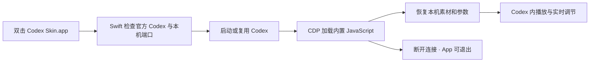
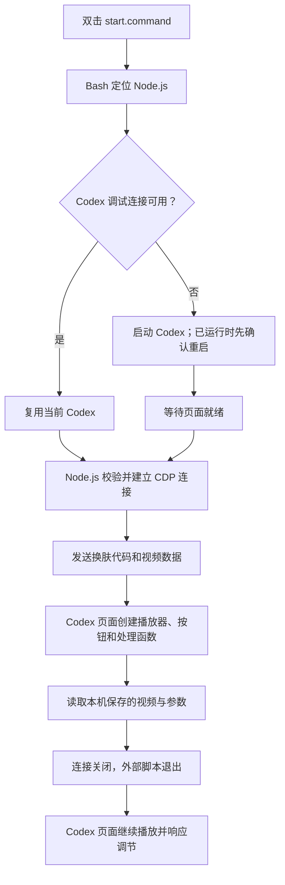
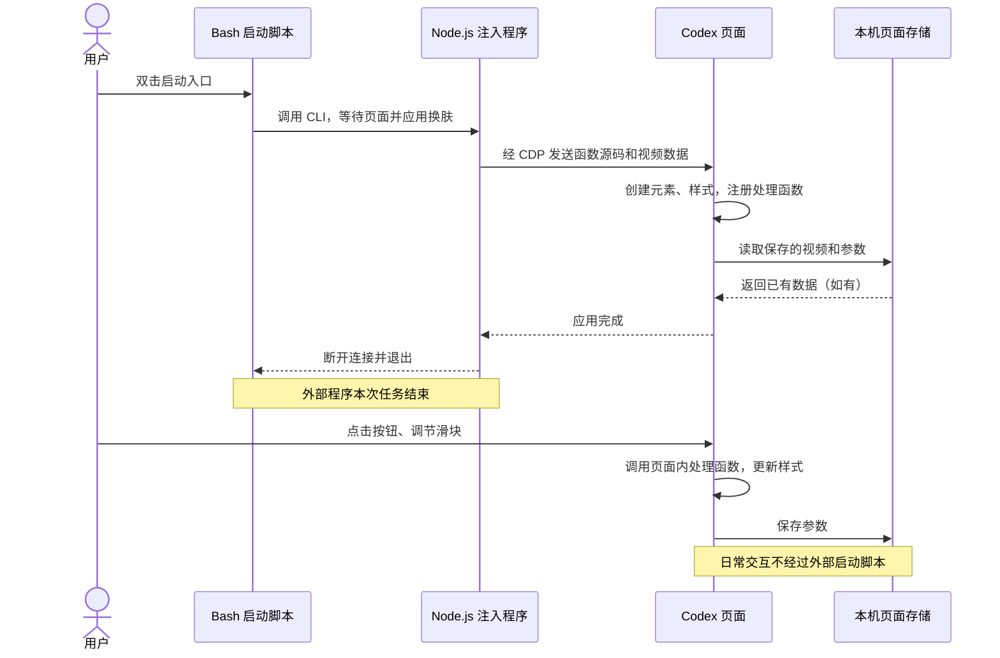
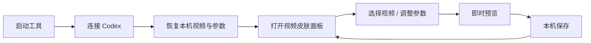

# Codex Video Skin · macOS 本地皮肤工具

把本地视频或图片放在 Codex 原生界面背后，视频静音循环播放。代码不修改 ChatGPT.app、账号、模型设置或原有 DreamSkin 配置。

## macOS App（推荐）

构建产物：`dist/Codex Skin.app`；分发镜像：`dist/Codex-Skin-0.3.0-macOS.dmg`。打开 DMG，将 App 拖到其中的 Applications 快捷方式，再从“应用程序”打开。使用者不需要安装 Node、打开终端或运行服务器。App 要求 macOS 13+，包含 Apple Silicon 与 Intel 两种架构；当前实机验证为 Apple Silicon。

1. 打开 App，点击 **启动并应用皮肤**。Codex 尚未启动时自动启动；已开启换肤连接时直接复用；普通启动时会提示确认重启，不会强制结束进程。
2. 以前选过背景则恢复已保存的背景与参数；第一次使用会打开 Codex 内的设置面板，选择本地视频或图片即可。
3. **打开皮肤设置** 显示 Codex 右下角面板；**恢复原生界面** 清除当前注入层，保留已保存的素材与参数。
4. 完成后关闭 App，视频继续播放。普通重启 Codex 不会自动恢复注入，需再次打开本 App 应用。



App 的 Swift 层只负责启动、连接与操作反馈。构建时，`scripts/build-payload.mjs` 把我们自己编写的 `renderer.mjs`、`theme.mjs`、`panel.mjs` 序列化到 App 资源 `skin.js`。运行时直接发送该资源，不下载远程脚本、不内置 Node、不读取聊天内容、不打包用户的视频，也不修改官方 App 文件。端口固定使用已登记的本机 `10270`，只连接签名验证通过的官方 Codex 主窗口，排除内嵌网页与宠物窗口。

### 构建与验收

开发机安装 Xcode Command Line Tools 和 Node.js 22+ 后运行 `npm run build:app`；不需要 npm install。运行 `npm run build:dmg` 会重新构建 App 并生成经过校验的 DMG。`npm run acceptance:app` 启动真实 App，点击检查连接并输出结果 JSON，完成后退出。此验收要求 Codex 已打开本机换肤连接，不会自动重启或改变背景。`npm test` 验证共享核心的真实 Chromium 播放、交互、参数和恢复。

当前包仅做 **ad-hoc 本机签名**，尚未使用 Developer ID 签名与 Apple 公证。适合本机试用；公开分发前仍需开发者证书、公证与下载来源验证。未实现自动更新、开机启动或后台驻留。官方 Codex 更新可能改变调试接口或页面结构，需回归验证。

## 脚本使用（保留）

- 双击 `start.command`：启动/连接支持视频背景的 Codex。普通启动的 Codex 需要确认重启。
- 双击 `control.command`：暂停、继续、调整遮罩、恢复原生界面或查看播放状态。
- 点击 Codex 右下角 **皮肤设置**，选择本地视频并实时调整；完成后收起面板。
- 文字深浅、全局遮罩、左侧栏透明度、输入框透明度、文字阴影、完整显示/填满窗口均可调。透明度 0% 实底，100% 完全透明；文字本身不跟随透明度变淡。
- 参数按视频内容的 SHA-256 保存；再次选择同一内容的视频自动恢复。当前视频保存在本机 IndexedDB，只有一份活动视频副本；换视频时覆盖这份副本，参数仍按视频分别保留。
- 下次双击 `start.command` 会恢复已保存的视频与参数。普通启动不自动注入，仍需使用此启动入口。显式 `apply 文件路径` 会替换保存的活动视频。
- 视频推荐 H.264 MP4，建议 1080p / 30fps，最大 64 MiB。图片支持 PNG、JPEG、WebP，单边上限 16384 像素，同样限制 64 MiB。设置面板也允许选择 WebM / MOV，但能否播放取决于其内部编码；选择不支持的文件会提示错误并保留当前视频。首次命令行应用失败会清理注入层。

脚本入口需要 macOS、`/Applications/ChatGPT.app` 和 Node.js 22+。不需要 npm install、数据库、Docker 或 HTTP 服务。工具优先使用 PATH 中的 Node，然后使用客户端内置 Node / 本机 nvm。

## 架构：脚本如何让换肤功能留在 Codex 中

本项目提供 **Swift 原生 App** 和 **Bash + Node.js 脚本** 两种入口，共用同一套 Codex 页面内 JavaScript；不是 Codex 官方插件。它不修改 Codex 安装文件，没有后台常驻注入服务。

### 文件、语言与运行位置

| 文件 / 技术 | 运行在哪里 | 职责 | 何时结束 |
| --- | --- | --- | --- |
| `app/main.swift`、`app/Bridge.swift`：Swift | 独立 macOS App | 原生窗口、签名与端口校验、启动 Codex、CDP 加载内置换肤核心 | 用户关闭 App 后退出；不影响已加载皮肤 |
| `scripts/build-app.sh`、`scripts/build-payload.mjs`：Bash / JavaScript | 开发机构建时 | 编译双架构 App、打包共享核心和分发 ZIP | 构建结束后退出；用户机器无需运行 |
| `start.command`：Bash | macOS 终端进程 | 连接现有 Codex，或启动带本机调试接口的 Codex；调用 Node.js 注入程序 | 应用完成或报错后退出 |
| `scripts/env.sh`：Bash | 启动脚本所在进程 | 定位 Node.js，进入项目目录 | 随启动脚本结束 |
| `src/cli.mjs`：JavaScript | 外部 Node.js 进程 | 校验连接对象、读取视频、发送换肤代码和视频数据 | 操作完成后关闭连接并退出 |
| `src/cdp.mjs`：JavaScript | 同一个 Node.js 进程 | 通过 WebSocket 封装 CDP 请求与返回结果 | 随 Node.js 进程结束 |
| `src/renderer.mjs`：JavaScript | 函数源码被发送到 Codex 页面后，在该页面内执行 | 创建视频、遮罩和样式；处理播放、暂停、透明度和清理 | 页面重载、关闭或主动恢复原生界面时清除 |
| `src/theme.mjs`：JavaScript | Node.js 测试与 Codex 页面 | 参数定义、范围校验、深浅配色和旧配置默认值 | 随调用环境结束 |
| `src/panel.mjs`：JavaScript、HTML、CSS | 函数源码被发送到 Codex 页面后，在该页面内执行 | 创建右下角设置面板、注册交互、保存视频与参数 | 随页面或换肤功能清除 |
| `control.command`：Bash | 用户另行启动的终端进程 | 调用 CLI，临时连接已有换肤功能进行控制 | 本次控制结束后退出 |

`.command` 是 macOS 可通过终端双击执行的脚本入口后缀，本项目的首行 `#!/bin/bash` 指定使用 Bash。Shell 可以调用其他程序，所以能够通过 `node src/cli.mjs apply` 执行 JavaScript；JavaScript 的解释执行由 Node.js 负责。`.mjs` 表示 ES 模块格式的 JavaScript 文件。

### 启动与注入链路

1. 用户双击 `start.command`，Bash 先找到可用的 Node.js。
2. 如果当前 Codex 已开放可验证的调试接口，就直接复用；如果未启动则启动；如果已经运行却未开放接口，则提示用户确认重启。端口被无法验证的进程占用时停止，不抢占端口。
3. 启动 Codex 时指定本机调试地址 `127.0.0.1:10270`，等待受支持的主页面就绪。脚本可以先启动，但必须等页面存在后才能注入。
4. Node.js 程序检查端口所属进程，连接目标页面，通过浏览器调试协议 **CDP（Chrome DevTools Protocol）** 的 `Runtime.evaluate` 让页面执行我们的函数源码。
5. 页面创建视频播放器、遮罩和 CSS。默认 MP4 从本机读取，经 CDP 分块传入页面，在页面中组装成 Blob 并播放；不需要 HTTP 视频服务器。
6. 页面创建设置面板，读取本机保存的视频和参数。默认应用会尝试恢复上次视频，显式指定视频路径则以指定文件为准。
7. 应用完成后，Node.js 关闭 CDP 连接，启动脚本退出。之后的视频播放和面板交互由 Codex 内部的页面环境负责。



### 为什么脚本退出了，右下角按钮还在？

**函数执行完毕，不等于函数创建的页面元素和事件处理函数被删除。** 注入代码执行时已经把按钮加入 Codex 页面的元素树（DOM），并注册了“点击时执行什么”“滑块变化时执行什么”等事件监听器。只要页面还保留这些元素和监听器，它们就继续存在。

按钮通过 `position: fixed`、`right: 18px`、`bottom: 18px` 固定在窗口右下角；设置面板使用 Shadow DOM 隔离内部样式，减少和 Codex 原生样式相互影响。视频由 Codex 内部的 HTML 视频播放器持续播放，不依赖外部脚本循环驱动。

点击按钮时，Codex 的页面引擎直接调用已经保留在页面内存中的函数。**Codex 不需要持续向外部启动脚本发送消息，外部脚本也不需要一直运行。** 用户后来主动执行 CLI 或 `control.command` 时，才会另行建立一次临时 CDP 连接。



### 生命周期与持久化

| 操作 | 页面里的换肤功能 | 本机保存的视频和参数 |
| --- | --- | --- |
| 外部启动脚本退出 | 继续运行，不受影响 | 保留 |
| 收起设置面板 | 按钮和播放器继续存在 | 保留 |
| 暂停视频 | 播放暂停，设置仍可调 | 保留 |
| 执行 `restore` 恢复原生界面 | 清理视频、面板、样式和监听器 | 保留，供以后重新应用 |
| 页面重载或 Codex 完全退出 | 当前页面里的注入内容消失 | 通常保留 |
| 再次通过启动入口应用 | 重新创建换肤功能，恢复保存内容 | 读取并继续使用 |
| 清理对应客户端站点存储 | 不等同于主动撤销当前页面代码 | 保存的数据被清除 |

样式参数存入页面的 `localStorage`，以视频内容的 SHA-256 为标识；当前视频 Blob 存入 `IndexedDB`，只保存一份活动视频副本。它们属于当前 Codex 的本机页面存储，不是外部服务，也不会把视频上传到网络。更换视频前先检查解码；存储失败时面板会提示，当前预览可以继续，但下次恢复可能失败。

当前版本没有开机自启、后台监控或新窗口自动注入。直接点击原来的 Codex 图标不会自动调用我们的脚本，需要使用 `start.command`。以后可以把这个入口包装成 macOS 启动器 App，但目前尚未实现。脚本断开连接也不会关闭 Codex 已开启的调试端口；完全退出后从原图标正常启动，才会回到未开启调试接口的启动方式。

## 可调参数（第二版）

沿用原有右下角“皮肤设置”入口，按功能折叠分组，标题和操作栏在滚动时保持可用。共 23 个基础调节项及 10 个独立配色角色。所有参数按背景文件内容保存，旧版配置自动补充新增参数的默认值；重置、撤销、重做仅改变当前背景参数。

| 分组 | 参数与行为 |
| --- | --- |
| 透明度与文字 | 全局遮罩、左侧栏、输入框、信息面板、设置页卡片、聊天区、用户消息透明度，以及文字阴影强度 |
| 背景与外观 | 系统自动／深色／浅色外观，完整显示／填满窗口，水平与垂直焦点，亮度、对比度、饱和度、模糊、视频速度 |
| 阅读与面板 | 内容安全区（无／左／右）、安全区遮罩强度，任务页背景（氛围／完整／关闭），面板圆角与边线宽度 |
| 主题配色 | 背景、面板、次级面板、强调色、次级强调色、辅助色、高亮、正文、次要文字、分隔线 |
| 配置与分享 | JSON 导入／导出、生成的 CSS 只读预览与导出、撤销／重做、重置、恢复默认配色 |

### 参考截图中的参数对应

这里只对齐用户提供的工作室截图中可见的参数能力；实现独立编写，不依赖或复制第三方运行时代码。

| 截图能力 | 本工具实现 |
| --- | --- |
| 背景图片 | “更换背景”同时支持本地图片和视频 |
| 默认外观：自动／浅色／深色 | 自动跟随系统深浅模式；可手动选择两种界面外观 |
| 水平／垂直焦点 | 0–100%，调整图片或视频 object-position；裁切／留白方向决定实际可见的移动 |
| 安全区：无／左／右 | 为指定一侧增加渐变底色，提高可读性，不改变布局或挪动消息 |
| 任务页：氛围／完整／关闭 | 氛围将背景素材可见度降至 35%；完整保持素材；关闭隐藏素材并暂停视频，仍保留基础背景颜色；首页保持完整素材 |
| 十项主题颜色 | 十个颜色选择器及 HEX 输入，支持 #RRGGBB 和 #RRGGBBAA |
| 配色对比度 | 正文与面板实色的对比度估算；不保证动态画面每一帧的实际对比度 |
| 导入／导出与撤销 | 本工具参数 JSON、CSS 导出、最多 60 步调整历史；不宣称兼容 DreamSkin ZIP 包或其 theme.json 格式 |

CSS 预览展示本工具生成的样式，不提供第三方脚本执行或任意 CSS 注入。分享参数不附带背景素材、文件路径或账号数据；使用者需另行选择自己的背景。网站账号、审核、主题商城和跨平台客户端不属于此脚本的参数面板。

### 信息面板透明度

“信息面板透明度”控制右上角 Outputs / Sources 容器。默认 88%，100% 时完全透明。只在外层绘制一次底色，并清除内部滚动标题及其装饰层的实色背景；不改变容器定位、层级、鼠标事件或滚动行为。输入框与信息面板共用可调圆角和边线，聊天正文不被施加整体 opacity。

### 配置校验与恢复

颜色只接受六位或八位 HEX，数值按参数范围校验，未知参数和不支持的配置版本会被拒绝。导入先整体校验再应用，错误配置不会部分覆盖现有参数。自动外观改变默认配色；用户设置的自定义颜色仍优先，可点击“恢复当前外观配色”清除覆盖。

启动时即使 `media/background.mp4` 不存在，也会直接尝试恢复 IndexedDB 中的当前背景。如果没有保存的背景，则打开设置面板让用户选择文件。无需为了恢复背景保留最初文件的路径。

## 透明阅读模式

默认聊天区全透明，侧栏及输入框仅有 12% 不透明度的深色底，全窗遮罩 30%。只改背景的 alpha，不对整个容器设置 opacity，所以文字和图标不会一起变淡。局部覆盖原生中性色为浅色，配合轻微阴影，不修改用户保存的浅色/深色主题设置；恢复时一并撤销。

视频默认 contain 完整显示；窗口比例与视频不同时会留边。可用控制入口选择 cover 铺满，但会裁切部分画面。面板薄底与全窗遮罩可分别调整；高亮视频下完全透明不能保证所有文字始终达到固定对比度。弹出菜单随文字模式采用相配的实底，聊天区域不使用大块底板。

## 调整与加载流程

1. 双击 `start.command` 连接当前 Codex（未开启本地调试连接时需要重启）。
2. 点击右下角“皮肤设置”，选择背景；先验证解码，再替换当前视频。
3. 暗背景选择浅色文字，亮背景选择深色文字；遮罩随之采用深色或浅色。
4. 拖动各滑块即时预览，参数自动保存在此 Codex 本机用户配置中。点击“完成”收起面板。
5. 重新应用时读取本机保存的视频及其参数。清理客户端站点存储会清除这些设置。



视频不会上传。存储失败会在面板提示，此时可继续预览，但不能保证下次恢复。重置只恢复当前视频的样式参数，不删除视频。系统减少动态效果优先于播放按钮。

## 验收素材

本地素材为用户提供的 MOV（4K、30fps、18.2 秒）。`media/background.mp4` 是保持原画面内容、降至 1080p 的静音播放副本；原始 MOV 未修改。素材仅用于本机验收，不包含在源码分享范围内，分享前需另行确认素材权利。

## 控制命令

```sh
node src/cli.mjs apply
node src/cli.mjs apply /absolute/path/to/video.mp4
node src/cli.mjs pause
node src/cli.mjs resume
node src/cli.mjs dim 0.30
node src/cli.mjs glass 0.12
node src/cli.mjs fit contain
node src/cli.mjs status
node src/cli.mjs restore
npm test
```

## 边界

- 默认只在当前打开的受支持 Codex 主窗口应用；没有后台常驻注入器。重载页面或新开窗口后需要重新应用。
- 尊重系统“减少动态效果”，开启时暂停视频。页面隐藏时暂停；窗口只是被其他窗口遮住时不一定触发隐藏事件。
- 恢复会删除本工具的视频、遮罩、CSS、监听器和 Blob URL，不覆盖其他主题配置。
- 恢复界面不等于关闭 CDP。完全退出 Codex 后，从官方图标正常打开，调试端口才关闭。
- 独占注册端口 10270（Codex CDP）；自动化测试临时使用 10271。仅回环地址，应用连接前检查监听进程归属。CDP 本身没有认证，不向网络暴露。
- 若检测到 DreamSkin 正在注入，会拒绝叠加。需要先暂停它。
- 其他 Codex 版本、完整菜单链路和长期耗电表现需分别验证。当前版本覆盖视频、图片与可调主题参数。

## 参考

参考 wxqdoit/codex-dream-skin-marketplace 的 macOS 视频方式、CCDawn/Codex-Dynamic-Skin 的生命周期设计及 Fei-Away/Codex-Dream-Skin 的原生界面层级思路。本目录的播放器和控制代码为独立实现，未拷贝这些项目的实现文件。

检查结果保存在本地 `work/`，截图可能包含客户端界面，仅用于本机验收，不应打包分享。

## 设置面板验收

`npm test` 使用隔离 Chrome 配置，验证实际鼠标点击、原生文件选择输入、深浅文字、独立透明度、参数持久化、活动视频恢复、错误视频保留现状、重置与清理。测试结束退出该浏览器并释放 10271。实际 Codex 使用播放与样式元数据验证；完整视觉效果由用户在当前窗口验收。

## 浏览器侧栏兼容

视频和遮罩分别位于负层级 -2、-1，并由页面根元素隔离背景堆叠。换肤不修改 `#root` 的定位和 z-index，不覆盖浏览器视图的 pointer-events、可见性或焦点。Codex 的内置网页挂载在主界面之外；抬高整个主界面会让透明区域遮住网页并截获点击。

回归测试使用挂在 `#root` 外部的 iframe 模拟浏览器侧栏，验证浅色/深色文字模式下的真实点击和输入。该测试不替代 Electron webview 的实际客户端复测。测试需要本机 FFmpeg，自动在忽略的 `work/` 中生成纯色测试视频，不再依赖用户素材。

设置控件的外层容器不接收鼠标事件，只让可见的按钮和面板接收事件，因此展开面板底部的透明空白不会挡住后方内容。控件使用 z-index 20，不再使用接近整数上限的层级；回归测试覆盖与其重叠的 z-index 50 菜单、列表、弹窗，以及浏览器原生模态对话框的顶层。这里的测试通过不代表已遍历 Codex 所有原生菜单、终端、编辑器和其他版本的挂载方式，新增界面仍需实际复测。


### 0.3 App 首版本验收记录

- 双架构编译、ad-hoc 签名验证和 ZIP 打包通过；共享核心 3 项自动化测试通过，含真实 Chromium 场景及 App 内置 payload 的重复注入、素材与参数恢复。
- Apple Silicon 实机已通过原生 UI 点击检查连接、应用、打开设置、恢复，再次应用；已检查 App 窗口的真实截图和辅助功能树。
- 退出测试 App 后，Codex 视频解码帧继续增长，右下角设置仍存在；使用原有本机参数。测试 App 与隔离 Chrome 已退出，测试端口 10271 已释放；原有 Codex 10270 保持运行。
- 未实际重启用户的 Codex 来验证“未启动 / 未开启调试”路径；实现正常退出、用户确认和超时，不强杀。Intel 仅交叉编译，尚未实机测试。其他机器下载后的 Gatekeeper 放行、公证与安装分发尚未验证。

### 设置页卡片

皮肤设置 → 透明度与文字 → **设置页卡片透明度**，0% 实底、100% 完全透明，默认 55%。底色跟随主题的“次级面板”，文字跟随当前配色；只改变卡片背景，不降低文字或开关透明度。适配原生设置分组的 panel token 和直接设置行容器，不改变层级或点击区域。旧配置缺少该项时自动使用默认值。

透明度滑块（侧栏、输入框、信息面板、设置卡片、聊天区、消息）统一按“越高越透明”显示。保存格式仍使用原有 alpha，因此既有参数与导入文件的视觉效果保持不变。设置页下拉选择框单独适配深浅配色，保留原生禁用状态和点击行为。

### 透明输入框与聊天内容

聊天滚动容器的实际高度扣除底部输入区高度，浏览器通过原生 overflow 裁切内容，快速滚动不再依赖 JavaScript 逐帧更新 clip-path。输入框保留原生绝对定位及原来的父节点，不增加遮罩、不搬动 React 节点；视频仍铺满窗口。

只在输入区高度、窗口尺寸或页面结构变化时更新布局，去除原先为悬浮输入框预留的重复占位。阅读历史时保持正文视觉位置，位于最新消息时保持底部锚定。恢复原生界面或退出聊天页时恢复原有内联属性并释放观察器。

验证包括：同一帧内 80 次来回滚动的命中测试、正常及反向滚动布局、输入框增高、末尾消息可达性、真实输入与恢复。原生消息查找、所有附件/展开模式仍需实际使用验证。只支持输入区定位容器位于滚动容器外部的已知布局；未来 Codex 改变该结构时不强行改动。

### 代码块面板

“代码块透明度”默认 35%，统一标题栏和正文的半透明底色，并添加轻微阴影与分隔线。100% 时背景、阴影与新增边线消失；文字及语法高亮不随容器变淡。只适配带原生 code-block 标记的代码块，不修改行内代码、复制事件或横向滚动。

### 配色兼容整理

公共颜色映射和未知实色组件兜底集中到 `src/compatibility.mjs`，App 与脚本共用。已适配区域继续支持透明；可识别但未适配的实色组件优先保留原生配色。覆盖清单、设计边界和新增适配要求见 [COMPATIBILITY.md](COMPATIBILITY.md)。这不保证任意 Codex 新组件都可自动识别。

### 开发后的固定回归

每次修改后主动遵循 [项目约定](AGENTS.md)，按 [历史问题与回归清单](REGRESSION.md) 检查。公共配色策略见 [兼容说明](COMPATIBILITY.md)。实际页面未验证时必须明确注明，不能仅凭自动测试宣称全部兼容。

### Dark / Light 双方案

皮肤设置顶部的“编辑方案”会通过 Codex 原生设置接口切换 Theme，并加载对应皮肤配置；面板自身也跟随深浅变化。两套方案共用背景文件，其余参数独立保存。原生设置页仍不参与换肤。

- 每个参数和颜色旁的按钮只同步该项到另一方案。
- “全部同步到 …”复制全部参数并覆盖目标方案；不会切换当前视图。
- 撤销/重做覆盖两套方案，切到目标方案后仍可撤销刚才的同步。
- 新版 JSON 使用 version 2，包含 dark/light 两套配置。旧版参数导入为 Dark，并为 Light 建立初始副本（默认改用深色文字）。Light 仍需自行检查和调整。
- 同步全部会连同配色一起复制，目标方案可能需要重新调整可读性。
- 原生 Theme 接口不可用或切换失败时显示错误，不伪造全局主题，也不删除参数。该接口属于 Codex 内部接口，升级后需重新验证。
