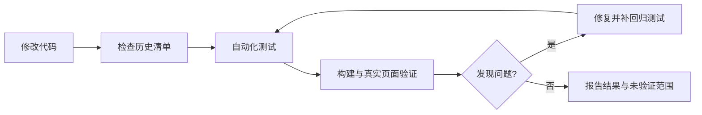

# 历史问题与必查回归

## 第一期个人皮肤库（开发中）

- 共享模型与原生存储测试：同素材多方案独立、草稿版本冲突保留、删除引用保护、导入导出往返、素材校验、写入失败不覆盖原库。
- 原生 App smoke 模式只允许请求的动作；`--smoke check` 不得被其他事件带入 apply、restore 或重启操作。验收结果必须核对 action，不能只看 success。
- 已接入 App 列表管理、面板保存/另存、离线草稿同步、迁移备份与失败回滚。自动回归覆盖操作回执幂等、连续离线保存、冲突副本、同素材独立配置、存储失败、原生 JSON 键顺序和页面并发写入；真实视觉未验证项见 PHASE1-ACCEPTANCE.md。

本清单是每次修改后的固定检查依据。已有自动测试不代表所有实际页面均已覆盖。

## 一路遇到的问题

| 类别 | 实际现象 | 根因或设计缺口 | 固定检查 |
| --- | --- | --- | --- |
| 视频与文字 | 暗视频文字清楚，换亮背景后难读 | 字体颜色写死，缺少成套主题参数 | 深/浅/自动文字模式；深、浅、复杂背景；保存后重载 |
| 设置场景混色 | 白色页面配深卡片黑文字 | 页面容器被原生兜底接管，子卡片仍保留主题 | 设置场景完整实色配色；进入暂停视频、离开恢复；无 settings-row 的页面与类名内背景变量；不修改用户参数 |
| 原生白底 | 输入框、设置下拉框、搜索框、文本域、权限表格出现白底浅字 | 只改文字，遗漏对应背景或组件 token | 背景、文字、提示文字、光标、图标、边框成套检查 |
| 同类文字混色 | 项目名蓝、灰、黑混杂 | 兜底误判悬停层，原生弱化与主题叠加 | 普通、悬停、移出、选中、展开、禁用及恢复 |
| 辅助按钮闪色 | Show more 在白灰间变化 | 原生悬停色与颜色过渡叠加；静止采样未复现持续闪烁 | 深浅模式下连续悬停/移出、DOM 更新期间逐帧检查稳定色 |
| 兜底残留 | 背景已透明，文字仍保留旧色 | 旧记录未清理，颜色 alpha 解析和变化监听不完整 | 类名移除、内联背景变化、状态属性变化、节点移除 |
| 区域遮挡 | 左栏、聊天区、信息面板挡住背景 | 未区分区域背景与透明度，内部重复绘制背景 | 各透明度 0/50/100%，不能降低整个组件 opacity |
| 边界溢出 | 左栏右边界和窗口最右边出现黑边 | 背景范围或伪元素超出实际区域 | 收起/展开、调整宽度、窗口缩放、两侧边界 |
| 点击被挡 | 右侧网页可见却点不到 | 抬高整个主界面层级，覆盖原生浏览器 | 浏览器点击/输入/滚动；菜单、设置面板空白穿透 |
| 输入区穿透 | 聊天文字穿过透明输入框，快滚时短暂闪现 | 输入区覆盖聊天滚动区，脚本裁剪更新滞后 | 固定布局隔离；快速滚动、多行输入、附件、窗口缩放 |
| 代码块不统一 | 标题不透明，正文直接透视频 | 标题与正文使用不同背景 | 单一面板、独立透明度、阴影、复制、语法高亮 |
| 状态与分发 | 保存参数不等于重启后自动注入 | 参数持久化、注入生命周期和 App 打包是不同环节 | 再注入、恢复保存背景、App/CLI 一致、清除皮肤 |

## 每轮必须执行

1. 阅读清单，明确本次影响的组件及公共规则。
2. 运行 `npm test`，覆盖既有 Chromium 行为回归与参数测试。
3. 运行 `git diff --check`，检查改动没有误动用户内容。
4. 核心或 App 有改动时重新打包并运行 `npm run acceptance:app`。
5. 在当前 Codex 验证影响区域，保留现有媒体与参数。
6. 把结果记录为“通过 / 失败 / 未验证”，不能以未出现报错代替验证。

纯文档修改检查内容、链接和 diff 即可，不必启动客户端。

## 真实页面矩阵

| 页面/区域 | 检查目标 |
| --- | --- |
| 左侧栏 | 项目名、任务名、图标、普通/选中/悬停/移出、折叠、边界 |
| 聊天区 | 正文、链接、气泡、代码块标题与正文、复制按钮 |
| 输入区 | 已输入文字、提示文字、光标、多行、附件、快速滚动穿透 |
| 右侧浏览器 | 新标签工具按钮、地址栏、网页点击与输入、滚动 |
| 信息面板 | Outputs/Sources、内部标题、透明度与面板边界 |
| General | 分组卡片、下拉框、开关、禁用与提示文字 |
| Personalization | 多行文本框、提示文字、光标、保存按钮 |
| Keyboard shortcuts | 搜索框、按键标签、菜单与焦点 |
| Computer use | 权限表格、表头/表体、选择器、语义状态 |
| Git | 分支前缀、各说明文本域、选项、提示文字 |
| 弹层 | 菜单、列表、对话框的层级、文字、点击和关闭 |
| 皮肤设置 | 全部参数、深浅模式、透明度端点、即时生效、保存与重载 |

全局配色或布局改动要覆盖整个矩阵。局部改动验证相关页面和邻近交互；其余注明本轮未复测。

## 必须保持的原则

- 背景和文字成对管理；未知组件不能被只改一半。
- 状态色表达含义，不随意抹平错误、警告、禁用等差异。
- 视频层不接收点击，不抬高整个主界面去压住原生网页。
- 透明输入框只透背景，不透聊天文字；优先浏览器布局约束。
- 未知表面兜底须能撤销，不能把低透明度悬停层当成不透明面板。
- 不保证任意视频配任意透明度都清晰；不得靠当前一张暗背景验证所有主题。
- Codex 更新后需重新验证结构兼容；不得承诺未来版本永久兼容。

最新范围：设置页不再适配主题。上表的设置页用例改为核对原生外观完全保留，并验证进入/退出设置的停用与恢复；不是检查主题色覆盖成功。

双方案回归：原生 Theme 与面板方案同步切换；视频不因 Dark/Light 切换被隐藏；独立调整、逐项双向同步、全部覆盖、跨方案撤销与重做；v1 迁移、v2 导出/导入和错误导入原子性。原生设置页停用换肤的规则不变。

说明弹窗回归：问号打开原生模态对话框，关闭按钮与 Escape 可关闭；焦点回到问号、皮肤面板保持打开，关闭后不残留遮挡。逐项同步统一使用双纸张复制图标，悬停明确显示源方案与目标方案，不表达互换。

同步反馈：单项/全部复制后在皮肤设置标题栏预留区域显示短暂状态提示，标明目标方案；不挤动面板、不拦截点击。撤销仍使用底部已有按钮。

复制 Tooltip：悬停 150ms 显示方向，移出/点击/滚动/关闭时清理；支持键盘聚焦与 Escape，不重复原生 title，不拦截点击、不超出窗口。

方案开关：原生 Theme 切换确认成功后显示标题栏状态提示；连续操作替换提示并重新计时，不堆叠、不拦截点击。

设置面板拖动：标题栏可拖动，按钮不触发拖动，入口仍在右下角；关闭重开保留位置；窗口/面板尺寸变化后限制边界，双击标题栏复位；帮助弹窗与原生网页点击不受影响。

## 每轮 App / 网页同步检查

- 对照本次功能变更，逐项检查 App 与 `docs/` 演示的参数、默认值、作用区域和操作结果；新增、修改、删除均需同步。
- 面板拖动/复位、复制/撤销、主题切换/提示、聊天独立滚动/固定输入框、滚动条及弹窗行为，覆盖本次相关路径；不能只检查文字介绍。
- 检查介绍、帮助、版本和下载说明，不把仅在开发版实现的能力说成已发布 DMG 的能力；网页不能执行的原生能力明确说明边界。
- 网页改动后构建站点、运行测试和 diff 检查，验证生成资源引用；真实浏览器验证相关路径。无网页影响时记录理由；无法实测时标记未验证。
- 交付记录区分：本地 App、网页演示、线上 Pages、发布 DMG。未推送/未部署不得称为线上已同步。

自动入库回归：无需同步按钮，App 打开期间自动接收保存、另存与草稿；离线重连自动补齐；失败重试不丢保存；前台操作与自动同步不并发写入；未变化快照不重复写入；App 不提供皮肤设置按钮。

原生个人库 UI 回归：运行 npm run acceptance:ui 检查深浅外观、窄/默认/宽窗口、长名称、空库、当前皮肤删除保护及草稿选择保留；真实 App 验证工具栏、更多菜单、新建/取消和连接反馈。文案只保留必要内容，空闲状态栏隐藏；不重新加入同步或皮肤设置按钮。

App 主题预览：npm run acceptance:ui 在隔离 WKWebView 验证图片/视频/纯色/草稿、双方案参数与配色、视频播放及暂停、缺失素材清理、快速切换、空库、预览前后库数据不变。真实 App 验证左右布局、切换方案和选择皮肤仅改变预览；最小化/关闭不留播放。预览与介绍页共用 src/demo 的布局、样式、参数效果和资料弹窗，不代表真实 Codex 页面全量验证。

共用演示回归：App 不包含网页设置按钮；纯色不显示网页默认风景；实际素材解码后使用共用参数效果；聊天滚动不穿透输入区，窄窗口不横向溢出，资料弹窗可打开关闭。Dark/Light 的自动配色以当前演示方案为准。组件变更同时构建两端，已安装版本不远程热更新。

同步门禁：`npm run test:sync` 在隔离无端口 Headless Chrome 中对比网页与 App 预览的 DOM、实际配色/透明度/边框/文字、三档宽度与 Dark/Light、聊天滚动/输入区隔离/弹窗/本地图片；故意修改生成 CSS 或仅 App CSS 必须失败，App 构建不得继续产出二进制。pre-commit 验证暂存区坏、工作区好的情况仍被阻止。完整 npm test 包含该套测试。

CI/CD 回归：版本 SemVer 校验、预发布版本在任何远端写入前拒绝、正式版设为 Latest、已发布跳过/草稿重试/tag 冲突；校验或上传失败不得公开 Release，安装包与校验文件齐备才发布；Pages 对同内容跳过、源码/下载版本变化更新，旧版说明及新版操作文案准确。GitHub Actions 语法用 actionlint 检查，DMG 构建与校验文件实际验证。CI 不运行需要真实 Codex 的 acceptance:app；本地照常执行。

云端视频回归：播放测试显式设定初始 reduced-motion 为 no-preference，之后仍验证 reduce 时暂停；等待真实时间与解码帧推进并在超时输出状态，不依赖固定 700ms 延迟或 runner 的系统辅助功能偏好。
悬停测试先把复制按钮滚入可视区域并等待布局完成，再执行真实鼠标移入；云端等待提示出现有明确上限，不能用 DOM 事件伪造悬停结果。

Headless 清理回归：Chrome 主进程退出后，Linux 子进程可能短暂写入 profile；临时目录删除对 ENOTEMPTY/EBUSY 使用有限重试，超过上限仍失败，不能掩盖同步断言失败。

原生关闭快捷键：文件菜单提供 ⌘W，通过原生 responder chain 关闭当前窗口；处理中仍阻止关闭。acceptance:ui 的 layout 验收覆盖快捷键分发、忙碌保护和当前窗口选择。网页不接管浏览器 ⌘W，本次无需同步演示组件。

工具栏平铺回归：全部九项操作直接放在第一行，780/980/1200 宽度均不得折叠；空库、草稿、当前皮肤的禁用和删除保护保持一致。

右键与双击回归：右键未选中行操作该行而非旧选择；菜单打开期间刷新保持目标 ID；当前皮肤/带草稿皮肤禁止删除，草稿禁止重命名及导出；空白右键仅导入，空白双击不应用；双击有效行复用应用及草稿确认流程，忙碌期间不重复执行。

原生视觉细化回归：图标工具栏全部操作保留文字与辅助功能标签，780 宽度不折叠；深浅外观下侧栏材质、强调色及禁用状态可辨，预览边距不导致内容溢出；右键、重命名取消、Dark/Light、⌘W 保持可用。

窗口标题精简：标题栏不显示“我的皮肤”，系统窗口名与辅助功能识别仍保留；工具栏、关闭和拖动不受影响。

工具栏留白不得产生玻璃胶囊：实际截图检查激活/未激活窗口、普通及禁用按钮，保留上方留白且无整组描边或玻璃背景；用原生按钮本体承载绘制边距，不包通用工具栏容器。

左右背景一致：列表背景与滚动容器透明，共用窗口 windowBackgroundColor；不使用 sidebar 模糊材质。深浅外观、激活/未激活及窗口后方内容变化时，选中行之外的左右底色保持一致，保留选中高亮。

连接状态回归：启动检测与轮询状态常驻显示，无连接时应用/恢复/草稿删除禁用，本地管理保持可用；菜单栏、右键、双击和工具栏共享门禁。连接成功及断开自动更新；显式连接才可请求启动/重启，取消不退出 Codex；应用前重检，轮询与前台操作不并发写入。隔离原生验收覆盖四种状态及按钮、菜单权限，真实断线状态和重启取消需验证。

连接状态位置：底部状态栏始终可见，空闲仅显示连接状态；操作消息出现和消失不改变栏高，预览右上只保留预览控件，长错误不挤掉连接状态。
