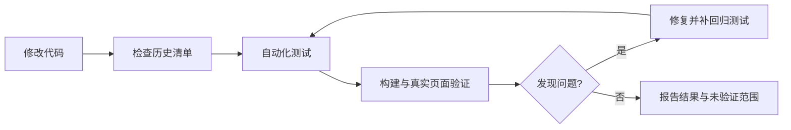

# 历史问题与必查回归

本清单是每次修改后的固定检查依据。已有自动测试不代表所有实际页面均已覆盖。

## 一路遇到的问题

| 类别 | 实际现象 | 根因或设计缺口 | 固定检查 |
| --- | --- | --- | --- |
| 视频与文字 | 暗视频文字清楚，换亮背景后难读 | 字体颜色写死，缺少成套主题参数 | 深/浅/自动文字模式；深、浅、复杂背景；保存后重载 |
| 设置场景混色 | 白色页面配深卡片黑文字 | 页面容器被原生兜底接管，子卡片仍保留主题 | 设置场景完整实色配色；进入暂停视频、离开恢复；无 settings-row 的页面与类名内背景变量；不修改用户参数 |
| 原生白底 | 输入框、设置下拉框、搜索框、文本域、权限表格出现白底浅字 | 只改文字，遗漏对应背景或组件 token | 背景、文字、提示文字、光标、图标、边框成套检查 |
| 同类文字混色 | 项目名蓝、灰、黑混杂 | 兜底误判悬停层，原生弱化与主题叠加 | 普通、悬停、移出、选中、展开、禁用及恢复 |
| 辅助按钮闪色 | Show more 在白灰间变化 | 原生悬停色与颜色过渡叠加；静止采样未复现持续闪烁 | 深浅模式下连续悬停/移出、DOM 更新期间逐帧检查稳定色 |
| 兜底残留 | 背景已透明，文字仍保留旧色 | 旧记录未清理，颜色 alpha 解析和变化监听不完整 | 类名移除、内联背景变化、状态属性变化、节点移除 |
| 区域遮挡 | 左栏、聊天区、信息面板挡住背景 | 未区分区域背景与透明度，内部重复绘制背景 | 各透明度 0/50/100%，不能降低整个组件 opacity |
| 边界溢出 | 左栏右边界和窗口最右边出现黑边 | 背景范围或伪元素超出实际区域 | 收起/展开、调整宽度、窗口缩放、两侧边界 |
| 点击被挡 | 右侧网页可见却点不到 | 抬高整个主界面层级，覆盖原生浏览器 | 浏览器点击/输入/滚动；菜单、设置面板空白穿透 |
| 输入区穿透 | 聊天文字穿过透明输入框，快滚时短暂闪现 | 输入区覆盖聊天滚动区，脚本裁剪更新滞后 | 固定布局隔离；快速滚动、多行输入、附件、窗口缩放 |
| 代码块不统一 | 标题不透明，正文直接透视频 | 标题与正文使用不同背景 | 单一面板、独立透明度、阴影、复制、语法高亮 |
| 状态与分发 | 保存参数不等于重启后自动注入 | 参数持久化、注入生命周期和 App 打包是不同环节 | 再注入、恢复保存背景、App/CLI 一致、清除皮肤 |

## 每轮必须执行

1. 阅读清单，明确本次影响的组件及公共规则。
2. 运行 `npm test`，覆盖既有 Chromium 行为回归与参数测试。
3. 运行 `git diff --check`，检查改动没有误动用户内容。
4. 核心或 App 有改动时重新打包并运行 `npm run acceptance:app`。
5. 在当前 Codex 验证影响区域，保留现有媒体与参数。
6. 把结果记录为“通过 / 失败 / 未验证”，不能以未出现报错代替验证。

纯文档修改检查内容、链接和 diff 即可，不必启动客户端。

## 真实页面矩阵

| 页面/区域 | 检查目标 |
| --- | --- |
| 左侧栏 | 项目名、任务名、图标、普通/选中/悬停/移出、折叠、边界 |
| 聊天区 | 正文、链接、气泡、代码块标题与正文、复制按钮 |
| 输入区 | 已输入文字、提示文字、光标、多行、附件、快速滚动穿透 |
| 右侧浏览器 | 新标签工具按钮、地址栏、网页点击与输入、滚动 |
| 信息面板 | Outputs/Sources、内部标题、透明度与面板边界 |
| General | 分组卡片、下拉框、开关、禁用与提示文字 |
| Personalization | 多行文本框、提示文字、光标、保存按钮 |
| Keyboard shortcuts | 搜索框、按键标签、菜单与焦点 |
| Computer use | 权限表格、表头/表体、选择器、语义状态 |
| Git | 分支前缀、各说明文本域、选项、提示文字 |
| 弹层 | 菜单、列表、对话框的层级、文字、点击和关闭 |
| 皮肤设置 | 全部参数、深浅模式、透明度端点、即时生效、保存与重载 |

全局配色或布局改动要覆盖整个矩阵。局部改动验证相关页面和邻近交互；其余注明本轮未复测。

## 必须保持的原则

- 背景和文字成对管理；未知组件不能被只改一半。
- 状态色表达含义，不随意抹平错误、警告、禁用等差异。
- 视频层不接收点击，不抬高整个主界面去压住原生网页。
- 透明输入框只透背景，不透聊天文字；优先浏览器布局约束。
- 未知表面兜底须能撤销，不能把低透明度悬停层当成不透明面板。
- 不保证任意视频配任意透明度都清晰；不得靠当前一张暗背景验证所有主题。
- Codex 更新后需重新验证结构兼容；不得承诺未来版本永久兼容。

最新范围：设置页不再适配主题。上表的设置页用例改为核对原生外观完全保留，并验证进入/退出设置的停用与恢复；不是检查主题色覆盖成功。

双方案回归：原生 Theme 与面板方案同步切换；视频不因 Dark/Light 切换被隐藏；独立调整、逐项双向同步、全部覆盖、跨方案撤销与重做；v1 迁移、v2 导出/导入和错误导入原子性。原生设置页停用换肤的规则不变。

说明弹窗回归：问号打开原生模态对话框，关闭按钮与 Escape 可关闭；焦点回到问号、皮肤面板保持打开，关闭后不残留遮挡。逐项同步统一使用双纸张复制图标，悬停明确显示源方案与目标方案，不表达互换。

同步反馈：单项/全部复制后在皮肤设置标题栏预留区域显示短暂状态提示，标明目标方案；不挤动面板、不拦截点击。撤销仍使用底部已有按钮。

复制 Tooltip：悬停 150ms 显示方向，移出/点击/滚动/关闭时清理；支持键盘聚焦与 Escape，不重复原生 title，不拦截点击、不超出窗口。

方案开关：原生 Theme 切换确认成功后显示标题栏状态提示；连续操作替换提示并重新计时，不堆叠、不拦截点击。
