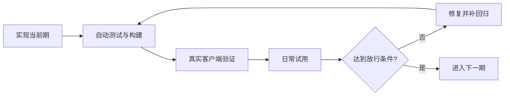

# 皮肤库与商店分期改造计划

记录日期：2026-10-10。

## 当前状态与接续入口

- 已实现：第一期个人库、面板保存与草稿同步、迁移备份、皮肤包、原生管理界面与网页演示；已有自动回归。
- 进行中：第一期验收与加固；真实 Codex 面板/网页视觉验证及用户试用尚未完成。第二至四期未开始。
- 下一步：依据 [PHASE1-ACCEPTANCE.md](PHASE1-ACCEPTANCE.md) 完成受限路径的用户复测，修复发现的问题；不启动第二期。
- 用户已明确开始第一期。完整库使用 Application Support/Codex Skin/Library；App 通过 JavaScriptCore 使用共享 JS 数据模型。页面离线草稿和桥接已接入，无后台常驻进程。
- 本项目不授权自动推送；计划记录和本地实现不等于发布授权。

## 产品方向

用户希望先管理多套个人皮肤，稳定后再扩展商店。

- **App**：完整的“我的皮肤”管理中心，后续增加 App 内“皮肤商店”。
- **Codex 面板**：当前皮肤、实时调节、保存与另存为；后续增加最近使用和收藏的快捷切换。
- **网页**：现有介绍与演示继续维护；公开商店预览、分享按需扩展，不是 App 用户安装皮肤的必经入口。

此前提出过“网页下载后手动导入”，用户指出寻找文件路径的负担。因此商店的主要使用链路改为：App 内浏览、预览、加入个人库、自动下载并保存、应用。不要回到以手动下载导入为主要体验的方案。

“商店在 App 内”不限定原生或内嵌网页技术。共用皮肤格式、目录数据和可复用逻辑，避免各入口各自维护一套模型。

## 第一期：可靠的个人皮肤库

目标：保存完整、切换准确、重启不丢失。状态：进行中，尚未达到放行条件。

### 1. 数据底座

- 每套皮肤有独立 ID、名称、背景素材、Dark 参数和 Light 参数。
- Dark / Light 是一套皮肤内部的两套配置，保留原生 Theme 切换与确认机制。
- 同一背景可保存多套不同效果，不再以背景内容作为唯一方案身份。
- App 本地库管理完整素材，共享素材按内容去重，删除皮肤不能破坏其他引用。
- 迁移前备份，失败保留旧数据；保留旧 JSON 导入导出，增加包含素材的皮肤包。
- 预留格式版本和来源信息，不提前实现商店网络功能。

当前实现基线：参数按背景内容保存，导出双方案配置不包含素材，当前媒体仅保留一份活动副本。开工时重新核对源码，不能把这段历史基线当作永远不变的现状。

### 2. 保存、草稿与同步

- 面板调节立即预览并自动保留草稿；“保存”更新命名皮肤，“另存为”创建副本。
- 切换前处理未保存修改：保存、保留草稿、放弃修改。
- 保持 App 关闭后面板仍可调节的能力；下次连接自动同步草稿，不提供手动同步按钮。
- 两端都有新修改时检查版本冲突，保留两份供用户选择，不静默覆盖。
- 应用失败保留原皮肤，不先破坏当前可用状态。
- App 管完整库、页面保留当前运行状态和草稿是拟定方向；可靠桥接与持久化需先验证。

### 3. 基础界面

- App 增加基础皮肤列表、新建、重命名、复制、删除、应用。
- 面板显示当前皮肤和保存状态，提供保存与另存为。
- 暂不做商店、账号、云同步、复杂分类或批量管理。

### 放行条件

- 同背景多方案互不覆盖；图片、视频、无媒体配置切换后参数准确。
- 完全退出后重新启动并应用能恢复内容；不把持久化说成自动注入。
- App 关闭后草稿可保存，再连接可同步，冲突不丢数据。
- 旧配置与新皮肤包导入导出往返一致。
- 损坏文件、素材缺失、写入失败、应用失败均不破坏原数据。
- 删除共享素材对应的某一皮肤不影响其他皮肤。
- 原生 Theme 切换失败时不显示成功，参数与实际状态一致。
- 准备无媒体、图片、视频测试皮肤，完成自动检查、真实客户端验证和日常试用。

## 第二期：顺手的管理体验

目标：皮肤多了也好找、好切换。状态：未开始；依赖第一期稳定。

- App 增加缩略图、收藏、搜索、最近使用。
- 面板增加收藏和最近皮肤的快捷切换。
- 明确 App 关闭时可切换的缓存范围；未缓存时提示打开 App 加载。
- 限制缓存占用，增加素材占用提示和删除恢复。
- 暂不接入商店与云同步。

放行条件：用 30 套测试皮肤验证搜索、滚动和连续切换；共享视频不按皮肤数量重复复制；App 关闭与缓存缺失时行为清楚；清理不误删仍被皮肤或草稿引用的素材。性能预算在实现前测量后确定。

## 第三期：App 内精选商店

目标：浏览到应用全程在 App 完成。状态：未开始；依赖个人库及管理体验稳定。

- App 增加商店列表、详情、模拟预览、加入我的皮肤、应用。
- 自动下载素材并保存，用户无需寻找下载路径。
- 显示下载状态，支持取消与失败后重试。
- 校验格式、兼容版本、大小和资源完整性，成功后才写入正式库。
- 记录来源版本；重复下载或更新不得覆盖用户修改。
- 首版仅提供维护者精选内容，可先使用静态目录与资源托管。
- 开工前选择原生界面或内嵌网页，不为未确定需求提前维护两套商店。
- 不做账号、投稿、评论、支付、云同步。
- 皮肤包限受支持参数与媒体，不引入任意执行脚本；公开素材须明确再分发许可。

放行条件：断网、取消、损坏资源、不兼容版本和重复下载处理正确；商店不可用不影响离线个人库；模拟预览明确边界，真实 Codex 验证最终应用效果。

## 第四期：公开分享与社区

状态：未开始；按实际需求决定是否启动，前三期可独立成为完整产品。

- 优先公开分享链接、网页预览、网页唤起 App 导入。
- 再评估作者、账号、投稿、审核、素材权利与下架处理。
- 云同步、支付和自动更新分别评估，不默认捆绑实施。

## 各期共同验收门槛

每期先实现，再自动测试和构建，再真实客户端验证，最后日常试用。建议观察 3–5 天，但时间不是稳定证据；发生数据丢失、错误覆盖或切换错乱，先修复并补回归，不进入下一期。不得自动安排试用提醒或宣称用户已验收。

- 遵循 AGENTS.md、REGRESSION.md、COMPATIBILITY.md；每次代码修改执行 `npm test`、`git diff --check`。
- 核心、主题、面板、打包或 App 改动执行 `npm run build:app`、`npm run acceptance:app`。
- 真实 Codex 验证影响及邻近区域；改全局样式时覆盖完整页面矩阵。
- 设置页保持原生，进入停用换肤并暂停视频，退出恢复原参数。
- 验证双方案、复制、撤销、原生 Theme 与 App/CLI 共用核心的一致性。
- 保护用户原媒体、参数及原先运行的 Codex；临时测试客户端验证后关闭。
- 每期检查 docs 参数、交互、帮助与版本说明；网页变化后运行 `npm run build:site` 并真实浏览器验证。
- 交付分别记录本地 App、网页演示、线上 Pages、发布 DMG 的状态，开发能力不冒充已发布能力。
- 关键路径无法验证时不得标记本期稳定；明确记录通过、失败、未验证及阻塞项。

## 接续记录

| 日期 | 工作 | 状态与下一步 |
| --- | --- | --- |
| 2026-10-10 | 保存分期计划并加入 AGENTS.md 入口 | 仅文档；功能未实施，下一步为第一期数据与同步方案核对 |

后续在此追加实现范围、验证证据、用户试用反馈、剩余问题和下一步，同时更新对应阶段状态。

### 2026-10-10 第一期实施记录（进行中）

- 新增 `src/library.mjs`：独立 ID、双方案内容、草稿、版本冲突与另存为、删除保护、旧配置解析。
- 新增 `src/library-repository.mjs`：可注入存储适配器的串行提交协议；原生实际存储由 Swift 实现，不在 App 中运行 Node。
- 新增 `app/Library.swift`：通过 JavaScriptCore 复用模型；文件锁、原子写入、修改前备份、SHA-256 素材去重与完整性校验、皮肤包导入导出。
- 构建增加 `library.js` 与原生存储类；尚未接入产品界面，不代表个人库已可使用。
- 自动检查：13 项测试通过（含真实 Chromium 既有行为及原生存储）；双架构 App 构建通过。后续修改仍须重新执行。
- 原生存储回归覆盖重开、素材复用、皮肤包往返、冲突保留、损坏素材、缺失素材、备份失败与原文件保护。
- 验收异常：首次 `acceptance:app` 请求 check，但报告 action=apply，未计为只读检查通过。已增加 smoke 动作白名单，防止非目标动作执行；复测明确返回 action=check、success=true。最初非目标动作的触发来源尚未确定。
- 当前仅新增内部能力，已检查 docs：暂无用户可见的新能力可演示，未更改网页；接入界面后必须同步说明与相关演示。线上 Pages 与已发布 DMG 均未更新。
- 真实个人库 UI、跨端保存同步、旧数据迁移、实际皮肤切换与用户试用均未验证；第一期未完成，不得标为稳定。

### 2026-10-10 第一期开发表面接通与验收（继续进行）

- 原生 App 已接入个人库列表、新建、命名、复制、删除、应用、同步及包导入导出。版本为 0.4.0-dev.1，未发布。
- 面板增加独立皮肤名称、草稿/待同步状态、保存与另存为；同背景多方案不再相互覆盖。离线保存以操作编号串联，同步重试不重复创建，冲突保留副本。
- 完成迁移前备份、素材校验、原子写入、页面写入版本校验、失败回滚、旧配置兼容与核心版本更新检查。
- 网页演示复用参数/会话/方案模型，支持本页内存中的保存、另存、切换和草稿恢复，明确不写入 App；已构建最新资源。
- 原生 UI 已实际验证新建、复制、重命名、同步、纯色应用和原背景恢复。原双方案参数与备份一致。导出仅确认成功反馈，文件目标及导入 UI 未完成验证。
- 真实 Codex App 被 Computer Use 拒绝，网页文件 URL 被 Browser Use 策略拒绝；没有绕过限制，不能声称视觉验收通过。已向用户请求手动复测。
- 完整验证范围、服务状态、交付入口与未验证项以 [PHASE1-ACCEPTANCE.md](PHASE1-ACCEPTANCE.md) 为准。线上 Pages 和已发布 DMG 未更新；无推送。

补充验收：原生导入与导出纯色包已通过真实 UI，并核对 work/acceptance-ui-roundtrip.json 的实际内容；删除仅验证提示，未在 UI 执行最终删除。其余工具受限视觉路径和用户日常试用仍待完成。

更正删除补测：原生删除提示后的自动化操作出现偏差，隔离库测试皮肤实际被删除，已用该库备份恢复（确认 1 套）。取消路径仍未通过，不计为稳定验收；默认用户库未受影响。

### 2026-10-10 自动入库交互调整

按用户要求移除 App 的同步与皮肤设置按钮。App 打开期间自动接收面板保存及草稿，关闭期间页面持久保存，重新打开自动接收。皮肤设置只从 Codex 内打开；无需新增后台服务。验证结果见 PHASE1-ACCEPTANCE.md。

### 2026-10-10 原生主窗口优化

使用项目 macos-patterns 指南重整 AppKit 窗口：系统外观、统一工具栏、inset 皮肤列表和更多菜单，移除强制蓝灰背景与空行条纹。保持第一期功能范围，未引入第二期缩略图/收藏功能。新增原生布局验收脚本，详细证据见 PHASE1-ACCEPTANCE.md。

### 2026-10-10 用户追加：应用前预览

用户明确要求在 App 中先预览主题，再决定是否应用，因此提前加入选择预览。左侧列表、右侧固定示例，使用实际素材与共享换肤核心，支持 Dark/Light、草稿及视频暂停。预览不写入库、不调用 Codex 应用或原生 Theme；第二期其他功能仍未启动。验收见 PHASE1-ACCEPTANCE.md。

### 2026-10-10 用户修正：复用介绍页演示

移除单独的 App 示例布局。`src/demo/` 统一维护网页与 App 的演示布局、样式、参数渲染和资料弹窗；App 以本地 WKWebView 加载构建资源，并传入个人库皮肤。网页设置面板留在网页，App 不增加设置入口。不引入在线依赖或远程脚本更新；同步指两端共用源码并分别构建。

### 2026-10-10 自动发布流水线

用户明确要求默认分支 push 后自动 CI/CD：所有 CI 成功才按新版本发布 tag、Release、DMG，并按内容变化部署 Pages。当前 0.4.0-dev.1 自动识别为预发布，官网仍下载最新正式版；配置流水线不代表第一期已通过用户试用门槛，也不启动后续阶段。不授权代理自动 push；云端运行状态见验收记录。
