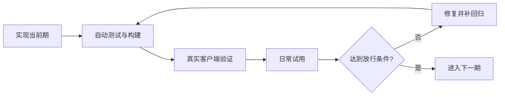

# 皮肤库与商店分期改造计划

记录日期：2026-10-10。

## 当前状态与接续入口

- 已实现：第一期个人库、面板保存与草稿同步、迁移备份、皮肤包、原生管理界面与网页演示；已有自动回归。
- 进行中：第一期验收与加固；真实 Codex 面板/网页视觉验证及用户试用尚未完成。第二至四期未开始。
- 下一步：依据 [PHASE1-ACCEPTANCE.md](PHASE1-ACCEPTANCE.md) 完成受限路径的用户复测，修复发现的问题；不启动第二期。
- 用户已明确开始第一期。完整库使用 Application Support/Codex Skin/Library；App 通过 JavaScriptCore 使用共享 JS 数据模型。页面离线草稿和桥接已接入，无后台常驻进程。
- 本项目不授权自动推送；计划记录和本地实现不等于发布授权。

## 产品方向

用户希望先管理多套个人皮肤，稳定后再扩展商店。

- **App**：完整的“我的皮肤”管理中心，后续增加 App 内“皮肤商店”。
- **Codex 面板**：当前皮肤、实时调节、保存与另存为；后续增加最近使用和收藏的快捷切换。
- **网页**：现有介绍与演示继续维护；公开商店预览、分享按需扩展，不是 App 用户安装皮肤的必经入口。

此前提出过“网页下载后手动导入”，用户指出寻找文件路径的负担。因此商店的主要使用链路改为：App 内浏览、预览、加入个人库、自动下载并保存、应用。不要回到以手动下载导入为主要体验的方案。

“商店在 App 内”不限定原生或内嵌网页技术。共用皮肤格式、目录数据和可复用逻辑，避免各入口各自维护一套模型。

## 第一期：可靠的个人皮肤库

目标：保存完整、切换准确、重启不丢失。状态：进行中，尚未达到放行条件。

### 1. 数据底座

- 每套皮肤有独立 ID、名称、背景素材、Dark 参数和 Light 参数。
- Dark / Light 是一套皮肤内部的两套配置，保留原生 Theme 切换与确认机制。
- 同一背景可保存多套不同效果，不再以背景内容作为唯一方案身份。
- App 本地库管理完整素材，共享素材按内容去重，删除皮肤不能破坏其他引用。
- 迁移前备份，失败保留旧数据；保留旧 JSON 导入导出，增加包含素材的皮肤包。
- 预留格式版本和来源信息，不提前实现商店网络功能。

当前实现基线：参数按背景内容保存，导出双方案配置不包含素材，当前媒体仅保留一份活动副本。开工时重新核对源码，不能把这段历史基线当作永远不变的现状。

### 2. 保存、草稿与同步

- 面板调节立即预览并自动保留草稿；“保存”更新命名皮肤，“另存为”创建副本。
- 切换前处理未保存修改：保存、保留草稿、放弃修改。
- 保持 App 关闭后面板仍可调节的能力；下次连接自动同步草稿，不提供手动同步按钮。
- 两端都有新修改时检查版本冲突，保留两份供用户选择，不静默覆盖。
- 应用失败保留原皮肤，不先破坏当前可用状态。
- App 管完整库、页面保留当前运行状态和草稿是拟定方向；可靠桥接与持久化需先验证。

### 3. 基础界面

- App 增加基础皮肤列表、新建、重命名、复制、删除、应用。
- 面板显示当前皮肤和保存状态，提供保存与另存为。
- 暂不做商店、账号、云同步、复杂分类或批量管理。

### 放行条件

- 同背景多方案互不覆盖；图片、视频、无媒体配置切换后参数准确。
- 完全退出后重新启动并应用能恢复内容；不把持久化说成自动注入。
- App 关闭后草稿可保存，再连接可同步，冲突不丢数据。
- 旧配置与新皮肤包导入导出往返一致。
- 损坏文件、素材缺失、写入失败、应用失败均不破坏原数据。
- 删除共享素材对应的某一皮肤不影响其他皮肤。
- 原生 Theme 切换失败时不显示成功，参数与实际状态一致。
- 准备无媒体、图片、视频测试皮肤，完成自动检查、真实客户端验证和日常试用。

## 第二期：顺手的管理体验

目标：皮肤多了也好找、好切换。状态：未开始；依赖第一期稳定。

- App 增加缩略图、收藏、搜索、最近使用。
- 面板增加收藏和最近皮肤的快捷切换。
- 明确 App 关闭时可切换的缓存范围；未缓存时提示打开 App 加载。
- 限制缓存占用，增加素材占用提示和删除恢复。
- 暂不接入商店与云同步。

放行条件：用 30 套测试皮肤验证搜索、滚动和连续切换；共享视频不按皮肤数量重复复制；App 关闭与缓存缺失时行为清楚；清理不误删仍被皮肤或草稿引用的素材。性能预算在实现前测量后确定。

## 第三期：App 内精选商店

目标：浏览到应用全程在 App 完成。状态：未开始；依赖个人库及管理体验稳定。

- App 增加商店列表、详情、模拟预览、加入我的皮肤、应用。
- 自动下载素材并保存，用户无需寻找下载路径。
- 显示下载状态，支持取消与失败后重试。
- 校验格式、兼容版本、大小和资源完整性，成功后才写入正式库。
- 记录来源版本；重复下载或更新不得覆盖用户修改。
- 首版仅提供维护者精选内容，可先使用静态目录与资源托管。
- 开工前选择原生界面或内嵌网页，不为未确定需求提前维护两套商店。
- 不做账号、投稿、评论、支付、云同步。
- 皮肤包限受支持参数与媒体，不引入任意执行脚本；公开素材须明确再分发许可。

放行条件：断网、取消、损坏资源、不兼容版本和重复下载处理正确；商店不可用不影响离线个人库；模拟预览明确边界，真实 Codex 验证最终应用效果。

## 第四期：公开分享与社区

状态：未开始；按实际需求决定是否启动，前三期可独立成为完整产品。

- 优先公开分享链接、网页预览、网页唤起 App 导入。
- 再评估作者、账号、投稿、审核、素材权利与下架处理。
- 云同步、支付和自动更新分别评估，不默认捆绑实施。

## 各期共同验收门槛

每期先实现，再自动测试和构建，再真实客户端验证，最后日常试用。建议观察 3–5 天，但时间不是稳定证据；发生数据丢失、错误覆盖或切换错乱，先修复并补回归，不进入下一期。不得自动安排试用提醒或宣称用户已验收。

- 遵循 AGENTS.md、REGRESSION.md、COMPATIBILITY.md；每次代码修改执行 `npm test`、`git diff --check`。
- 核心、主题、面板、打包或 App 改动执行 `npm run build:app`、`npm run acceptance:app`。
- 真实 Codex 验证影响及邻近区域；改全局样式时覆盖完整页面矩阵。
- 设置页保持原生，进入停用换肤并暂停视频，退出恢复原参数。
- 验证双方案、复制、撤销、原生 Theme 与 App/CLI 共用核心的一致性。
- 保护用户原媒体、参数及原先运行的 Codex；临时测试客户端验证后关闭。
- 每期检查 docs 参数、交互、帮助与版本说明；网页变化后运行 `npm run build:site` 并真实浏览器验证。
- 交付分别记录本地 App、网页演示、线上 Pages、发布 DMG 的状态，开发能力不冒充已发布能力。
- 关键路径无法验证时不得标记本期稳定；明确记录通过、失败、未验证及阻塞项。

## 接续记录

| 日期 | 工作 | 状态与下一步 |
| --- | --- | --- |
| 2026-10-10 | 保存分期计划并加入 AGENTS.md 入口 | 仅文档；功能未实施，下一步为第一期数据与同步方案核对 |

后续在此追加实现范围、验证证据、用户试用反馈、剩余问题和下一步，同时更新对应阶段状态。

### 2026-10-10 第一期实施记录（进行中）

- 新增 `src/library.mjs`：独立 ID、双方案内容、草稿、版本冲突与另存为、删除保护、旧配置解析。
- 新增 `src/library-repository.mjs`：可注入存储适配器的串行提交协议；原生实际存储由 Swift 实现，不在 App 中运行 Node。
- 新增 `app/Library.swift`：通过 JavaScriptCore 复用模型；文件锁、原子写入、修改前备份、SHA-256 素材去重与完整性校验、皮肤包导入导出。
- 构建增加 `library.js` 与原生存储类；尚未接入产品界面，不代表个人库已可使用。
- 自动检查：13 项测试通过（含真实 Chromium 既有行为及原生存储）；双架构 App 构建通过。后续修改仍须重新执行。
- 原生存储回归覆盖重开、素材复用、皮肤包往返、冲突保留、损坏素材、缺失素材、备份失败与原文件保护。
- 验收异常：首次 `acceptance:app` 请求 check，但报告 action=apply，未计为只读检查通过。已增加 smoke 动作白名单，防止非目标动作执行；复测明确返回 action=check、success=true。最初非目标动作的触发来源尚未确定。
- 当前仅新增内部能力，已检查 docs：暂无用户可见的新能力可演示，未更改网页；接入界面后必须同步说明与相关演示。线上 Pages 与已发布 DMG 均未更新。
- 真实个人库 UI、跨端保存同步、旧数据迁移、实际皮肤切换与用户试用均未验证；第一期未完成，不得标为稳定。

### 2026-10-10 第一期开发表面接通与验收（继续进行）

- 原生 App 已接入个人库列表、新建、命名、复制、删除、应用、同步及包导入导出。版本为 0.4.0-dev.1，未发布。
- 面板增加独立皮肤名称、草稿/待同步状态、保存与另存为；同背景多方案不再相互覆盖。离线保存以操作编号串联，同步重试不重复创建，冲突保留副本。
- 完成迁移前备份、素材校验、原子写入、页面写入版本校验、失败回滚、旧配置兼容与核心版本更新检查。
- 网页演示复用参数/会话/方案模型，支持本页内存中的保存、另存、切换和草稿恢复，明确不写入 App；已构建最新资源。
- 原生 UI 已实际验证新建、复制、重命名、同步、纯色应用和原背景恢复。原双方案参数与备份一致。导出仅确认成功反馈，文件目标及导入 UI 未完成验证。
- 真实 Codex App 被 Computer Use 拒绝，网页文件 URL 被 Browser Use 策略拒绝；没有绕过限制，不能声称视觉验收通过。已向用户请求手动复测。
- 完整验证范围、服务状态、交付入口与未验证项以 [PHASE1-ACCEPTANCE.md](PHASE1-ACCEPTANCE.md) 为准。线上 Pages 和已发布 DMG 未更新；无推送。

补充验收：原生导入与导出纯色包已通过真实 UI，并核对 work/acceptance-ui-roundtrip.json 的实际内容；删除仅验证提示，未在 UI 执行最终删除。其余工具受限视觉路径和用户日常试用仍待完成。

更正删除补测：原生删除提示后的自动化操作出现偏差，隔离库测试皮肤实际被删除，已用该库备份恢复（确认 1 套）。取消路径仍未通过，不计为稳定验收；默认用户库未受影响。

### 2026-10-10 自动入库交互调整

按用户要求移除 App 的同步与皮肤设置按钮。App 打开期间自动接收面板保存及草稿，关闭期间页面持久保存，重新打开自动接收。皮肤设置只从 Codex 内打开；无需新增后台服务。验证结果见 PHASE1-ACCEPTANCE.md。

### 2026-10-10 原生主窗口优化

使用项目 macos-patterns 指南重整 AppKit 窗口：系统外观、统一工具栏、inset 皮肤列表和更多菜单，移除强制蓝灰背景与空行条纹。保持第一期功能范围，未引入第二期缩略图/收藏功能。新增原生布局验收脚本，详细证据见 PHASE1-ACCEPTANCE.md。

### 2026-10-10 用户追加：应用前预览

用户明确要求在 App 中先预览主题，再决定是否应用，因此提前加入选择预览。左侧列表、右侧固定示例，使用实际素材与共享换肤核心，支持 Dark/Light、草稿及视频暂停。预览不写入库、不调用 Codex 应用或原生 Theme；第二期其他功能仍未启动。验收见 PHASE1-ACCEPTANCE.md。

### 2026-10-10 用户修正：复用介绍页演示

移除单独的 App 示例布局。`src/demo/` 统一维护网页与 App 的演示布局、样式、参数渲染和资料弹窗；App 以本地 WKWebView 加载构建资源，并传入个人库皮肤。网页设置面板留在网页，App 不增加设置入口。不引入在线依赖或远程脚本更新；同步指两端共用源码并分别构建。

### 2026-10-10 自动发布流水线

用户明确要求默认分支 push 后自动 CI/CD：所有 CI 成功才按新版本发布 tag、Release、DMG，并按内容变化部署 Pages。发布规则已改为只允许正式版，0.4.0 必须生成 Tag、DMG 和校验文件，官网同步最新下载；配置流水线不代表第一期已通过用户试用门槛，也不启动后续阶段。不授权代理自动 push；云端运行状态见验收记录。

### 2026-10-12 第一行操作平铺

- 移除更多菜单，九项操作直接放在原生展开式工具栏第一行；沿用原有禁用、删除保护及动作实现。
- npm test（30 项）、build:app、build:site、acceptance:ui、acceptance:app 通过。布局验收覆盖深浅外观及 780/980/1200 宽度全部按钮可见；真实 App 验证重命名打开与取消、列表/预览相邻布局。
- README、设计规范和 docs 说明已同步并标记未发布；演示组件本身不包含原生工具栏，无需修改。浏览器工具打开本地说明页超时，网页手动视觉检查未完成；Headless 同步门禁通过。线上 Pages 和已发布 DMG 未更新，未推送。
- 本轮未重测无关的 Codex 全页面主题矩阵；原有 Codex 与皮肤保留，临时 App 已关闭。不改变第一期仍需用户试用的状态。

### 2026-10-12 右键菜单与双击应用

- 列表右键提供应用、重命名、删除、导入、导出，绑定所点皮肤/草稿 ID，刷新后重新查找并校验权限；空白处仅导入。双击有效行复用既有应用流程，忙碌与空白处不执行。
- npm test 30 项、build:site、build:app、acceptance:ui、acceptance:app 通过。原生回归新增菜单目标、选中行、禁用状态、空白及忙碌保护；既有深浅外观、三档窗口和媒体预览回归通过。
- 真实 App 验证右键非选中皮肤、重命名目标及取消、当前皮肤禁删、导出窗口及取消、双击当前皮肤。操作前后皮肤专属 backup 完全一致（参数及媒体），未改用户名称、删除皮肤或写出导出文件。右键导入的最终文件导入和破坏性删除本轮未实测，底层既有自动测试通过。未扩展复测 Codex 无关页面矩阵。
- README、设计约定、docs 的未发布说明已同步；原生列表不属于网页演示组件，未伪造网页右键能力。站点构建及 Headless 同步门禁通过，网页说明手动视觉复查未完成。线上 Pages 与正式 DMG 未更新，无推送。临时 App 退出，原有 Codex 保持运行，无新增服务。

### 2026-10-12 原生视觉细化

- 九项平铺操作改为统一尺寸的图标加文字，使用分组间距与系统强调色突出应用；移除密集胶囊边框。列表使用原生 sidebar 材质，使用中图标及标记使用强调色；预览采用统一边距和次级标题。保持 AppKit/macOS 13、原有数据和功能。
- npm test 30 项、build:site、build:app、git diff --check 通过；acceptance:ui 的深浅外观、三档尺寸、全部按钮可见、空库/草稿/当前皮肤和媒体预览通过。真实新版 App 检查截图、重命名打开/取消、Dark/Light 预览、右键菜单及删除保护。
- acceptance:app 失败：当前 Codex 未开启换肤连接；没有重启用户 Codex，实际应用及注入端页面未复测。该项仍需在用户可重启 Codex 后验收，不宣称全量通过。
- docs/README 同步本地未发布外观说明并构建；共用网页演示组件未变，原生外框美化不属于网页聊天演示。网页说明手动视觉复核未完成。线上 Pages、正式 DMG 未更新，未推送。
- 按用户继续优化/复测的要求，本地 dist/Codex Skin.app 保持运行，无新增服务或端口。等待用户视觉反馈，不改变第一期阶段门槛。

### 2026-10-12 隐藏窗口标题文字

- 按截图红框隐藏标题栏“我的皮肤”，保留窗口系统名称；真实新版截图确认隐藏，App 保持运行供用户继续优化。
- npm test 30 项、build:app、git diff --check 通过。首次 acceptance:ui 的关闭快捷键断言失败，关闭旧实例后完整复测 populated/empty 的 layout/preview 均通过；未跳过检查。acceptance:app 仍因 Codex 未开启连接而失败，未重启 Codex。
- 已检查 docs 与共用演示：不展示原生标题栏，无需同步网页资源；线上 Pages、发布 DMG 未更新，无推送。未复测注入页面矩阵。

### 2026-10-12 工具栏顶部留白

- 按用户要求为每个工具栏按钮增加上方 10 点、下方 4 点留白，保留 48 点按钮及全部操作。真实新构建截图确认按钮远离标题栏，App 保持运行供复测。
- npm test 30 项、build:app、git diff --check 通过。首次 UI 验收关闭快捷键断言失败，关闭旧实例后重跑完整 acceptance:ui，空库/有数据布局与预览均通过。acceptance:app 仍因 Codex 未开启换肤连接失败；没有重启 Codex，未复测注入与应用链路。
- docs 共用演示没有原生工具栏，无须资源改动；设计文档同步间距。线上 Pages 与已发布 DMG 未更新，无推送，无新增服务。

### 2026-10-12 修正留白引入的玻璃背景

- 用户仅要求留白，上一轮使用 NSView 容器导致系统工具栏画出玻璃胶囊，属于视觉回归。移除容器，恢复无边框 NSButton 本体，以按钮内部绘制区域保留上 10/下 4 点边距。
- 真实 App 截图确认普通和激活状态均无玻璃胶囊，重命名点击及取消正常，预览正常。新版保持运行供用户复测。设计及回归清单补充禁止该背景。
- npm test 30 项、build:app、acceptance:ui、git diff --check 通过。acceptance:app 因 Codex 无换肤连接失败，未重启 Codex；注入链路未验证。网页无原生工具栏，无需同步资源；Pages、DMG 未发布，无推送。

### 2026-10-12 左右区域统一背景

- 按用户要求移除侧栏 NSVisualEffectView/sidebar 材质，窗口明确使用 windowBackgroundColor；透明列表与主区域共用同一实色底层，保留原生选中高亮。
- npm test 30 项、build:site、build:app、acceptance:ui 和 git diff --check 通过。实际新构建截图确认未激活及选中其他行后的左右底色一致，选择及纯色预览正常；新版保持运行供用户验收。
- acceptance:app 因 Codex 未开启换肤连接失败，未重启 Codex；注入页面及实际应用链路未复测。README/docs 与设计约定已同步，网页演示内的皮肤参数效果未改；网页说明手动浏览器复查未完成。Pages、正式 DMG 未更新，无推送，无新增服务。

### 2026-10-12 常驻连接状态与离线门禁

- 预览区右上固定宽度显示检查中、未连接、连接中、已连接，与自动接收复用 3 秒间隔轮询；检测仅探测当前受支持窗口，不启动/重启。连接就绪独立于是否已经注入皮肤。
- 工具栏和菜单入口改为连接 Codex；仅显式连接可启动或在确认后重启。应用不再隐式启动，未连接时应用、恢复和草稿删除不可执行，双击不应用；普通皮肤本地管理及预览继续可用。远端操作执行前重新确认连接，失败后刷新状态。
- npm test 30 项、build:site、build:app、acceptance:ui、git diff --check 通过。隔离原生验收新增四种连接状态与工具栏/右键权限检查，覆盖草稿和本地操作；已有轮询串行、失败重试与前台互斥测试通过。
- 真实 App 验证未连接常驻、应用/恢复禁用、双击只预览、右键应用禁用且本地管理可用；显式连接弹重启确认，取消后 Codex 不退出，连接状态恢复未连接。新版保持运行供复测。
- acceptance:app 连接检查仍失败（当前 Codex 未开放换肤连接）；未确认重启，真实连接成功、断开后重连及实际应用链路未验证，隔离状态测试不能代替这些结果。用户方便中断任务时可在 App 点击连接 Codex 完成后续验收。
- README、设计规范、docs 说明与站点构建已同步，明确未发布及网页无法执行本机连接；共用聊天演示不伪造连接能力。网页文件地址被浏览器安全策略阻止，未绕过，网页人工视觉复核未完成。线上 Pages、正式 DMG 未更新，无提交/推送，无新增端口或基础设施。

连接状态交付补充：同步未来 Pages 发布产物的启动说明，明确先连接再应用；对应 release.test 与完整 30 项测试通过。本地 build:dmg、hdiutil 校验及 SHA-256 核对通过，未发布安装包；本机没有 actionlint，未运行该检查（本轮未修改 workflow）。云端发布未执行。

### 2026-10-12 连接状态移到底部

- 按用户要求将连接状态从预览右上移至底部左侧，状态栏固定 32pt 高度并常驻；空闲隐藏操作消息，右上仅保留预览控件。离线操作门禁保持不变。
- npm test、build:site、build:app、acceptance:ui 通过；真实客户端截图及辅助功能树确认底部未连接状态、右上无连接文案、应用和恢复禁用。新版 App 保持运行供用户验收，无新增服务或端口。
- acceptance:app 仍因当前 Codex 未开放换肤连接失败，未重启 Codex，连接成功及实际应用未复测。README、设计规范、网页说明和发布启动文案同步；线上 Pages、已发布 DMG 未更新，网页人工视觉复核仍受此前安全策略限制。

2026-10-13 推送前复核：30 项测试及 build:site 同步门禁通过。修正 README 开发版连接步骤；发布产物的 RELEASE_START 继续保留已发布 v0.4.0 的操作步骤，新增测试防止未发布的底部状态栏/连接按钮混入旧版下载说明（取代此前发布文案同步记录）。版本号未变，不发布或覆盖 DMG。原生 App 构建和 UI 验收沿用上轮同一代码验证；实际 Codex 连接仍因环境未开启而未验证。
